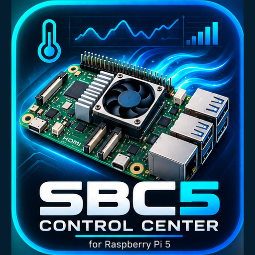

<p align="center">
  <a href="https://github.com/krlmdfk/sbc5-control-center">
    
  </a>
</p>

<h1 align="center">SBC5 Control Center</h1>

<p align="center">
  Raspberry Pi 5 control, cooling, diagnostics and optimization center for Home Assistant OS.<br>
  Centrum sterowania, chłodzenia, diagnostyki i optymalizacji Raspberry Pi 5 dla Home Assistant OS.
</p>

<p align="center">
  <a href="https://github.com/krlmdfk/sbc5-control-center/actions/workflows/validate.yml"></a>
  <a href="https://github.com/krlmdfk/sbc5-control-center/releases"></a>
  <a href="LICENSE"></a>
</p>

<p align="center">
  <a href="https://my.home-assistant.io/redirect/supervisor_add_addon_repository/?repository_url=https%3A%2F%2Fgithub.com%2Fkrlmdfk%2Fsbc5-control-center">
    
  </a>
</p>

<p align="center">
  <strong>Stable · v2.8.28 · Card UI 2.8.28 · aarch64 · HA OS ≥ 18.3 · Core ≥ 2026.10.1 · Apache-2.0</strong>
</p>

<p align="center">
  <a href="https://github.com/krlmdfk/sbc5-control-center"><strong>Main App</strong></a> ·
  <a href="https://github.com/krlmdfk/sbc5-control-center-integration"><strong>HACS Integration</strong></a> ·
  <a href="docs/FIRST_INSTALL.md"><strong>🚀 First Installation / Pierwsza instalacja</strong></a> ·
  <a href="DOCUMENTATION.md"><strong>Documentation</strong></a> ·
  <a href="docs/QUICK_SETUP.md"><strong>Quick Setup</strong></a> ·
  <a href="https://github.com/krlmdfk/sbc5-control-center/issues"><strong>Issues</strong></a>
</p>

---

**English** · [Polski](#polski)

## English

SBC5 Control Center combines Active Cooler control, Adaptive PWM, local AI Cooling, Raspberry Pi 5 telemetry, CPU/OC and GPU/V3D/ISP profiles, managed `config.txt`, Restart Manager, and safe local updates in one Home Assistant OS companion runtime.

### Project repositories

| Repository | Purpose |
|---|---|
| **[sbc5-control-center](https://github.com/krlmdfk/sbc5-control-center)** | Complete project: App/runtime, native integration source, cards, package, documentation, branding and release tooling. |
| **[sbc5-control-center-integration](https://github.com/krlmdfk/sbc5-control-center-integration)** | HACS-managed Home Assistant integration distributed separately for correct HACS ownership. |

> **HACS companion integration:** the HACS repository contains only the native Home Assistant integration. It requires the **SBC5 Control Center App/runtime** from this main repository to provide Raspberry Pi host telemetry and control services.

### Highlights

| Area | Capabilities |
|---|---|
| **Cooling** | Active Cooler, `custom1`, Automatic / Hybrid / Manual, PWM→RPM calibration |
| **Adaptive PWM** | `custom1(T)` base, bounded trim, deadband, anti-windup, Sign Guard, slew limiter |
| **AI Cooling** | local Learning/Assist, workload buckets, sample qualification, prediction history |
| **CPU / OC** | Factory → Experimental + Advanced profiles, Boot Verification, CPU0–CPU3 telemetry |
| **GPU / V3D / ISP** | Factory / Eco / Balanced / Performance / Experimental / Advanced profiles |
| **System** | power, PMIC, memory, storage, throttling, network, firmware and bootloader diagnostics |
| **`config.txt`** | managed blocks, backup, validation, rollback, semantic change detection |
| **Updates** | local ZIP, manifest, SHA-256 verification, Health Check, Restart Manager |

### Mobile-first Lovelace

The main card is optimized for phones. Detailed sections stay collapsed until requested:

- **SBC5 Control Center** expands update controls;
- **AI Cooling** expands learning, prediction and grid diagnostics;
- **CPU Clock** expands CPU0–CPU3 frequency and load;
- CPU and GPU profiles have independent expandable controls.

Performance layout: **CPU/PWM temperature chart → CPU / Overclocking → GPU/V3D/ISP**.

### Architecture

```text
Home Assistant OS
├── SBC5 Control Center App/runtime
│   ├── cooling / AI / profiles / config.txt
│   ├── update + restart manager
│   └── host telemetry
├── native integration: sbc5_control_center
├── Home Assistant package
└── Lovelace cards
```

### Lovelace dependencies

The native SBC5 integration works independently of third-party frontend cards. For the **complete SBC5 Control Center dashboard**, install through HACS:

- **Mushroom** — tiles, selectors and controls;
- **card-mod** — styling and dynamic layout;
- **ApexCharts Card** — temperature, PWM, AI prediction and history charts.

### Quick start

> **Installing SBC5 for the first time?** Start with the complete beginner guide: **[`docs/FIRST_INSTALL.md`](docs/FIRST_INSTALL.md)**.

1. Install and start the SBC5 Control Center App/runtime.
2. Verify `Platform Guard` and `Host Access`.
3. Calibrate the Active Cooler before aggressively reducing minimum PWM.
4. Install **Mushroom**, **card-mod**, and **ApexCharts Card** in HACS for the complete Lovelace dashboard.
5. Add or synchronize the main Lovelace card.
6. Change CPU/GPU profiles gradually and restart the Raspberry Pi host only when Restart Manager reports a real boot-configuration change.
7. Install the companion **[HACS integration](https://github.com/krlmdfk/sbc5-control-center-integration)** if you want native Home Assistant entities and device diagnostics.

Full guide: [`docs/QUICK_SETUP.md`](docs/QUICK_SETUP.md).

### Documentation

- [First Installation / Pierwsza instalacja](docs/FIRST_INSTALL.md)
- [Current project information](INFO.md)
- [Full documentation](DOCUMENTATION.md)
- [Quick Setup](docs/QUICK_SETUP.md)
- [Changelog](CHANGELOG.md)
- [`config.txt` reference](docs/CONFIG_TXT_REFERENCE.md)
- [Local ZIP updates](docs/LOCAL_ZIP_UPDATE.md)

### Safety and compatibility

SBC5 targets Raspberry Pi 5 with Home Assistant OS. The App requires extended host access because it manages cooling and optionally boot configuration. Overclocking and Device Tree changes can affect stability; verify temperature, power and throttling status after hardware-profile changes.

SBC5 Control Center is an independent project. Raspberry Pi and Home Assistant are names/trademarks of their respective owners. The project is not sponsored, endorsed or maintained by Raspberry Pi Ltd., Home Assistant or the Open Home Foundation. See `LICENSE`, `NOTICE`, `TRADEMARKS.md` and `THIRD_PARTY_NOTICES.md`.

---

## Polski

SBC5 Control Center łączy obsługę Active Coolera, Adaptive PWM, lokalne AI Cooling, telemetrię Raspberry Pi 5, profile CPU/OC i GPU/V3D/ISP, zarządzanie `config.txt`, Restart Manager oraz bezpieczne lokalne aktualizacje w jednym środowisku współpracującym z Home Assistant OS.

### Repozytoria projektu

| Repozytorium | Przeznaczenie |
|---|---|
| **[sbc5-control-center](https://github.com/krlmdfk/sbc5-control-center)** | Kompletny projekt: aplikacja/runtime, źródło natywnej integracji, karty, package, dokumentacja, branding i narzędzia publikacji. |
| **[sbc5-control-center-integration](https://github.com/krlmdfk/sbc5-control-center-integration)** | Integracja Home Assistant zarządzana przez HACS, dystrybuowana osobno dla prawidłowej własności HACS. |

> **Integracja HACS:** repozytorium HACS zawiera wyłącznie natywną integrację Home Assistant. Wymaga **SBC5 Control Center App/runtime** z tego głównego repozytorium, które dostarcza telemetrię hosta Raspberry Pi i usługi sterujące.

### Najważniejsze możliwości

| Obszar | Zakres |
|---|---|
| **Cooling** | Active Cooler, `custom1`, Automatic / Hybrid / Manual, kalibracja PWM→RPM |
| **Adaptive PWM** | baza `custom1(T)`, bounded trim, deadband, anti-windup, Sign Guard, slew limiter |
| **AI Cooling** | lokalny Learning/Assist, buckety obciążenia, kwalifikacja próbek, historia predykcji |
| **CPU / OC** | profile Factory → Experimental + Advanced, Boot Verification, taktowanie CPU0–CPU3 |
| **GPU / V3D / ISP** | profile Factory / Eco / Balanced / Performance / Experimental / Advanced |
| **System** | zasilanie, PMIC, pamięć, storage, throttling, sieć, firmware i bootloader |
| **`config.txt`** | zarządzane bloki, backup, walidacja, rollback, semantyczne wykrywanie zmian |
| **Updates** | lokalne ZIP, manifest, SHA-256, Health Check, Restart Manager |

### Mobile-first Lovelace

Główna karta jest zoptymalizowana pod telefon. Szczegółowe sekcje pozostają zwinięte do czasu ich wywołania:

- **SBC5 Control Center** rozwija opcje aktualizacji;
- **AI Cooling** rozwija diagnostykę uczenia, predykcji i siatki;
- **Zegar CPU** rozwija częstotliwość i obciążenie CPU0–CPU3;
- profile CPU i GPU mają niezależne rozwijane sterowanie.

Układ części wydajnościowej: **wykres temperatury CPU/PWM → CPU / Overclocking → GPU/V3D/ISP**.

### Architektura

```text
Home Assistant OS
├── SBC5 Control Center App/runtime
│   ├── cooling / AI / profiles / config.txt
│   ├── update + restart manager
│   └── host telemetry
├── natywna integracja: sbc5_control_center
├── package Home Assistant
└── karty Lovelace
```

### Zależności Lovelace

Natywna integracja SBC5 działa niezależnie od zewnętrznych kart frontendowych. Do działania **kompletnego dashboardu SBC5 Control Center** zainstaluj przez HACS:

- **Mushroom** — kafelki, selektory i elementy sterujące;
- **card-mod** — stylowanie i dynamiczny układ;
- **ApexCharts Card** — wykresy temperatury, PWM, predykcji AI i historii.

### Szybki start

> **Instalujesz SBC5 po raz pierwszy?** Zacznij od pełnego przewodnika dla początkujących: **[`docs/FIRST_INSTALL.md`](docs/FIRST_INSTALL.md)**.

1. Zainstaluj i uruchom SBC5 Control Center App/runtime.
2. Sprawdź `Platform Guard` i `Host Access`.
3. Uruchom kalibrację Active Coolera przed agresywnym obniżaniem minimalnego PWM.
4. Zainstaluj w HACS **Mushroom**, **card-mod** i **ApexCharts Card** dla kompletnego dashboardu Lovelace.
5. Dodaj lub zsynchronizuj główną kartę Lovelace.
6. Zmieniaj profile CPU/GPU etapami i restartuj host Raspberry Pi tylko wtedy, gdy Restart Manager zgłosi rzeczywistą zmianę konfiguracji boot.
7. Zainstaluj towarzyszącą **[integrację HACS](https://github.com/krlmdfk/sbc5-control-center-integration)**, jeśli chcesz natywne encje i diagnostykę urządzenia w Home Assistant.

Pełna instrukcja: [`docs/QUICK_SETUP.md`](docs/QUICK_SETUP.md).

### Dokumentacja

- [Informacje o aktualnym stanie](INFO.md)
- [Pełna dokumentacja](DOCUMENTATION.md)
- [Quick Setup](docs/QUICK_SETUP.md)
- [Changelog](CHANGELOG.md)
- [Reference `config.txt`](docs/CONFIG_TXT_REFERENCE.md)
- [Aktualizacje lokalne ZIP](docs/LOCAL_ZIP_UPDATE.md)

### Zgodność i bezpieczeństwo

SBC5 jest przeznaczony dla Raspberry Pi 5 z Home Assistant OS. Aplikacja ma rozszerzony dostęp do hosta, ponieważ zarządza chłodzeniem i opcjonalnie konfiguracją boot. Overclocking i zmiany Device Tree mogą wpływać na stabilność — po zmianach profili sprzętowych zawsze weryfikuj temperatury, zasilanie i stan throttlingu.

SBC5 Control Center jest niezależnym projektem. Raspberry Pi i Home Assistant są nazwami/znakami odpowiednich właścicieli; projekt nie jest przez nich sponsorowany, zatwierdzony ani utrzymywany. Zobacz `LICENSE`, `NOTICE`, `TRADEMARKS.md` i `THIRD_PARTY_NOTICES.md`.
