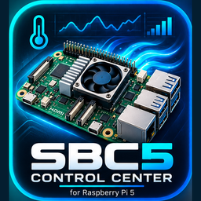

  

# SBC5 Control Center — Quick Setup Guide / Szybka konfiguracja

**[Main App / Główna aplikacja](https://github.com/krlmdfk/sbc5-control-center)** · **[HACS Integration / Integracja HACS](https://github.com/krlmdfk/sbc5-control-center-integration)**

---

## English

### 1. Requirements

- Raspberry Pi 5 / `aarch64`;
- Home Assistant OS `>= 18.3`;
- Home Assistant Core `>= 2026.10.1`;
- Mushroom, card-mod, and ApexCharts Card for the complete Lovelace card.

### 2. First start

1. Start SBC5 Control Center.
2. Verify `Platform Guard: OK`.
3. Verify `Host Access: SUCCESS`.
4. Confirm that the **SBC5 Control Center** device is visible in Home Assistant.
5. If the package or integration requires a reload, restart Home Assistant.

### 3. Cooling

1. Start with Automatic mode and a balanced configuration.
2. Run Active Cooler calibration.
3. Check RPM, PWM, and CPU temperature.
4. Do not reduce the minimum PWM below the stable value determined by calibration.

### 4. Lovelace card

Add `dashboard/sbc5_control_center_diagnostics_card.yaml`. The optional update card is available at `dashboard/update_status_card.yaml`.

The **SBC5 Control Center**, **AI Cooling**, and **CPU Clock** sections are collapsed by default. Tap a tile to expand details; tap it again to collapse them.

### 5. CPU / OC

1. Open the section below the CPU/PWM temperature chart.
2. Tap the CPU profile tile to expand profile selection and the Apply action.
3. Start with the Balanced profile if you need moderate overclocking.
4. After a real `config.txt` change, perform a full Raspberry Pi restart if requested by Restart Manager.
5. After boot, verify the saved and active clock values.
6. Tap **CPU Clock** to expand CPU0–CPU3.

### 6. GPU / V3D / ISP

1. Tap the GPU profile tile.
2. Select a preset.
3. Apply the profile.
4. If the resulting boot configuration changed, perform a full host restart.
5. Factory returns clock management to firmware control.

### 7. AI Cooling

1. Enable the AI section in the App configuration.
2. Leave it in Learning mode until enough qualified samples have been collected.
3. Tap **AI Cooling** to view bucket maturity, prediction, sample qualification, and grid information.
4. Enable Assist only after the collected data has reached sufficient quality.

### 8. Updates

1. Copy the ZIP package to `/config/sbc5_control_center_updates/`.
2. Tap the **SBC5 Control Center** tile on the update card.
3. Select **Check now**.
4. Install the package only after successful verification.
5. Perform only the restart requested by Restart Manager.

A full Raspberry Pi restart is not required merely because the version number changed; it is required only after a real boot configuration change.

### 9. Troubleshooting

Check in this order: App log → Host Access → Cooling Problem → power/throttling → Config Differs From Active → Restart Required → Package/Card UI version.

Full documentation: `DOCUMENTATION.md`.

---

## Polski

### 1. Wymagania

- Raspberry Pi 5 / `aarch64`;
- Home Assistant OS `>= 18.3`;
- Home Assistant Core `>= 2026.10.1`;
- Mushroom, card-mod i ApexCharts Card dla pełnej karty Lovelace.

### 2. Pierwszy start

1. Uruchom SBC5 Control Center.
2. Sprawdź `Platform Guard: OK`.
3. Sprawdź `Host Access: SUKCES`.
4. Zweryfikuj, czy urządzenie **SBC5 Control Center** jest widoczne w Home Assistant.
5. Jeśli package/integracja wymaga przeładowania, wykonaj restart Home Assistant.

### 3. Chłodzenie

1. Zacznij od trybu Automatic i zbalansowanej konfiguracji.
2. Wykonaj kalibrację Active Coolera.
3. Sprawdź RPM, PWM i temperaturę CPU.
4. Nie obniżaj minimalnego PWM poniżej stabilnej wartości wynikającej z kalibracji.

### 4. Karta Lovelace

Dodaj `dashboard/sbc5_control_center_diagnostics_card.yaml`. Opcjonalną kartę aktualizacji znajdziesz w `dashboard/update_status_card.yaml`.

Sekcje **SBC5 Control Center**, **AI Cooling** i **Zegar CPU** są domyślnie zwinięte. Dotknięcie kafelka rozwija szczegóły, ponowne dotknięcie je chowa.

### 5. CPU / OC

1. Otwórz sekcję pod wykresem temperatury CPU/PWM.
2. Dotknij kafelka profilu CPU, aby rozwinąć wybór i przycisk zastosowania.
3. Zacznij od profilu Balanced, jeśli potrzebujesz umiarkowanego OC.
4. Po realnej zmianie `config.txt` wykonaj pełny restart Raspberry Pi, jeśli zażąda go Restart Manager.
5. Po boot sprawdź zapisane i aktywne taktowanie.
6. Dotknij **Zegar CPU**, aby rozwinąć CPU0–CPU3.

### 6. GPU / V3D / ISP

1. Dotknij kafelka profilu GPU.
2. Wybierz preset.
3. Zastosuj profil.
4. Jeśli wynikowa konfiguracja boot się zmieniła, wykonaj pełny restart hosta.
5. Factory przywraca zarządzanie zegarami przez firmware.

### 7. AI Cooling

1. Włącz sekcję AI w konfiguracji aplikacji.
2. Pozostaw tryb Learning do zebrania próbek jakościowych.
3. Dotknij kafelka **AI Cooling**, aby zobaczyć dojrzałość bucketu, predykcję, kwalifikację próbki i siatkę.
4. Assist włączaj dopiero po uzyskaniu wystarczającej jakości danych.

### 8. Aktualizacje

1. Skopiuj paczkę ZIP do `/config/sbc5_control_center_updates/`.
2. Dotknij kafelka **SBC5 Control Center** na karcie aktualizacji.
3. Wybierz **Sprawdź teraz**.
4. Zainstaluj paczkę tylko po poprawnej weryfikacji.
5. Wykonaj wyłącznie restart wskazany przez Restart Manager.

Pełny restart Raspberry Pi nie jest wymagany przez samą zmianę numeru wersji; jest wymagany tylko po realnej zmianie konfiguracji boot.

### 9. Gdy coś nie działa

Sprawdź kolejno: log aplikacji → Host Access → Cooling Problem → zasilanie/throttling → Config Differs From Active → Restart Required → wersję package/Card UI.

Pełna dokumentacja: `DOCUMENTATION.md`.
